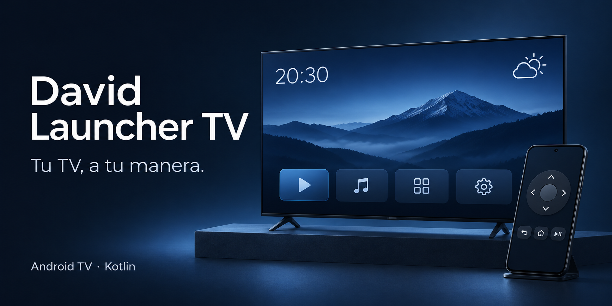

  

<h1 align="center">David Launcher TV</h1>

<strong>Tu TV, a tu manera.</strong> Un inicio minimalista para Android TV: tus apps, tus fondos y lo que necesitas ver.

  
  
  
  

  <a href="https://github.com/DavidCevallos15/david-launcher-tv/releases/tag/v0.5.0-preview.1"><strong>Descargar APK</strong></a> ·
  <a href="docs/INSTALLATION.md"><strong>Guía de instalación</strong></a> ·
  <a href="docs/TV-REMOTE.md">Control desde el celular</a> ·
  <a href="docs/DEVELOPMENT.md">Desarrollo</a>

La portada es una ilustración conceptual generada con IA; no es una captura de la aplicación.

## Un inicio hecho para tu TV

David Launcher TV reemplaza la pantalla de inicio por una interfaz inspirada en tvOS, sin anuncios ni recomendaciones dentro del launcher. Está escrito en Kotlin con el framework de Android, sin AndroidX ni bibliotecas de terceros en tiempo de ejecución aparte de Kotlin.

- **Tus apps, en tu orden.** Crea secciones, mueve tarjetas y fija las aplicaciones que ya tienes instaladas.
- **Fondos con personalidad.** Degradados integrados, imágenes y videos sin audio en bucle, con selección manual o rotación diaria.
- **La información a la vista.** Reloj, fecha, saludo y clima con el último dato guardado cuando no hay conexión.
- **Un modo para disfrutar el fondo.** Oculta el menú y deja el reloj, el clima y los controles multimedia en pantalla.
- **Ajustes desde el sofá.** Cambia fuentes, colores, tamaño de tarjetas y escala de la interfaz con el control remoto.
- **Un control en tu celular.** El módulo opcional TV Remote añade navegación, teclado, dictado y acceso al asistente del TV compatible.

No necesita root ni desbloquear el bootloader. La posibilidad de usarlo como inicio predeterminado depende del fabricante y del firmware.

## Descargar e instalar

**[Abrir la página de descargas →](https://github.com/DavidCevallos15/david-launcher-tv/releases/tag/v0.5.0-preview.1)**

| Aplicación | Instalar en | Descarga directa |
| --- | --- | --- |
| David Launcher TV 0.5.0 | Televisor o TV box Android | [david-launcher-tv.apk](https://github.com/DavidCevallos15/david-launcher-tv/releases/download/v0.5.0-preview.1/david-launcher-tv.apk) |
| TV Remote 0.1.0 — opcional | Celular Android | [tv-remote.apk](https://github.com/DavidCevallos15/david-launcher-tv/releases/download/v0.5.0-preview.1/tv-remote.apk) |

Esta primera descarga es una **vista previa con APK de depuración**, procedente de una compilación que superó las pruebas automáticas. Consulta las notas de la versión antes de actualizar una instalación existente. No es una publicación en Google Play.

1. Descarga **david-launcher-tv.apk**.
2. Transfiérelo al TV por USB o por tu red local y ábrelo con un gestor de archivos compatible.
3. Si el TV lo solicita, permite que ese gestor instale aplicaciones y confirma la instalación.
4. Abre **David Launcher TV** desde las aplicaciones. Pruébalo antes de cambiar el inicio predeterminado.

La **[guía paso a paso](docs/INSTALLATION.md)** explica la instalación sin compilar, la alternativa desde un computador, la configuración del botón Home y cómo desinstalarlo.

## Compatibilidad

| Componente | Requisito |
| --- | --- |
| Launcher para TV | Android 5.0+ / API 21; pensado para Android TV y Google TV |
| Control para celular | Android 8.0+ / API 26 |
| Conexión de TV Remote | Celular y TV en la misma red; Android TV Remote Service compatible con el protocolo v2 |
| Clima | Internet para actualizar; conserva el último dato guardado |
| Controles de música | Acceso a notificaciones y una app con sesión multimedia activa |

El dispositivo documentado como probado es **TCL BeyondTV2 con Android TV 11**. Otros modelos necesitan validación. Fire TV puede limitar el cambio de inicio y no garantiza compatibilidad con TV Remote. Samsung con Tizen y LG con webOS no ejecutan estos APK.

## Uso con el control del TV

| Quiero… | Acción |
| --- | --- |
| Ver el fondo y los widgets | **▲** desde la primera fila; **▼** o **Atrás** vuelve a abrir el menú |
| Personalizar el inicio | **◀** sobre la primera app para mostrar **Editar**, o pulsa **MENÚ** |
| Crear o cambiar filas | **Personalizar → Secciones** |
| Añadir una app a una sección | En **Apps**, mantén **OK** sobre la app y elige la sección |
| Reordenar una app | Mantén **OK** en el menú; **◀ ▶** mueve, **▲ ▼** cambia de sección, **OK** confirma y **MENÚ** la quita de la sección |
| Cambiar el fondo | **Fondos → ◀ ▶ → OK**; **Automático** elige uno distinto cada día |
| Cambiar el tamaño de la interfaz | **Personalizar → Zoom de toda la interfaz** (70–130 %) o **Tamaño de las tarjetas** |
| Controlar la música | Con el menú oculto, usa **◀ ▶ OK** sobre los controles multimedia |

También puedes ocultar el menú automáticamente después de 10, 30 o 60 segundos. Las apps nuevas aparecen en **Apps** sin modificar el código.

**Sobre el saludo:** esta versión muestra el nombre **David**. Para cambiarlo hay que modificar `LauncherConfig.USER_NAME` y volver a compilar; todavía no es un ajuste de la interfaz.

## TV Remote: tu celular como control

Instala el segundo APK en tu celular, conecta ambos dispositivos a la misma red y selecciona tu TV o escribe su IP. Introduce el código de seis caracteres que aparece en la pantalla del televisor.

- Clickpad con gestos, flechas, OK y pulsación larga.
- Teclado con modos **Auto / IME / Teclas**, según lo que admita el TV.
- Dictado desde el celular y envío de voz al asistente del TV, si lo soporta.
- Control de volumen desde los botones de la app o del propio celular.

TV Remote se conecta al servicio del televisor; no necesita que David Launcher TV sea el inicio predeterminado ni que ADB esté activo para usar el control.

**[Ver emparejamiento, funciones y solución de problemas →](docs/TV-REMOTE.md)**

## Permisos y privacidad

| Función | Qué utiliza |
| --- | --- |
| Clima | Consultas HTTPS a Open-Meteo. La ciudad automática consulta ipwho.is, con geojs.io como respaldo. Elegir una ciudad evita esas consultas de geolocalización, pero Open-Meteo sigue recibiendo la conexión y su IP de origen. |
| Música | El acceso a notificaciones permite consultar y controlar sesiones multimedia. El servicio actual no procesa el contenido de las notificaciones. Sin este permiso, el resto del launcher funciona. |
| Voz del control móvil | Permiso de micrófono cuando se usa la función. El dictado depende del servicio de reconocimiento del celular y puede necesitar Internet. |
| Emparejamiento del control | Identidad local cifrada con AndroidKeyStore y comprobación del certificado del TV después del emparejamiento. |

Los fondos personales se guardan en el almacenamiento de la app en el TV; no se incluyen en el APK ni en este repositorio.

## Documentación y contribuciones

- **[Instalación](docs/INSTALLATION.md):** descargas, USB, ADB, Home, actualización y restauración.
- **[TV Remote](docs/TV-REMOTE.md):** emparejamiento, teclado, voz y diagnóstico.
- **[Desarrollo](docs/DEVELOPMENT.md):** compilación, pruebas, arquitectura, fondos y personalización del código.
- **[Reportar un problema](https://github.com/DavidCevallos15/david-launcher-tv/issues/new):** incluye modelo del TV, versión de Android, versión de la app y pasos para reproducirlo. Revisa los registros antes de compartir datos de tu red.

Las contribuciones son bienvenidas. Para cambios de comportamiento, explica el problema, describe cómo lo probaste e indica el dispositivo utilizado si corresponde.

## Licencia

[MIT](LICENSE) · Creado por [David Cevallos](https://github.com/DavidCevallos15).

Las fuentes Poppins, Bebas Neue, Orbitron y Righteous se distribuyen bajo SIL Open Font License 1.1; sus licencias están en [licenses/fonts](licenses/fonts/).
